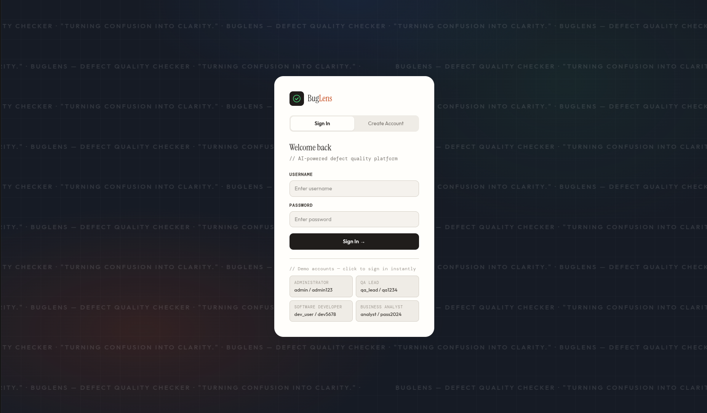
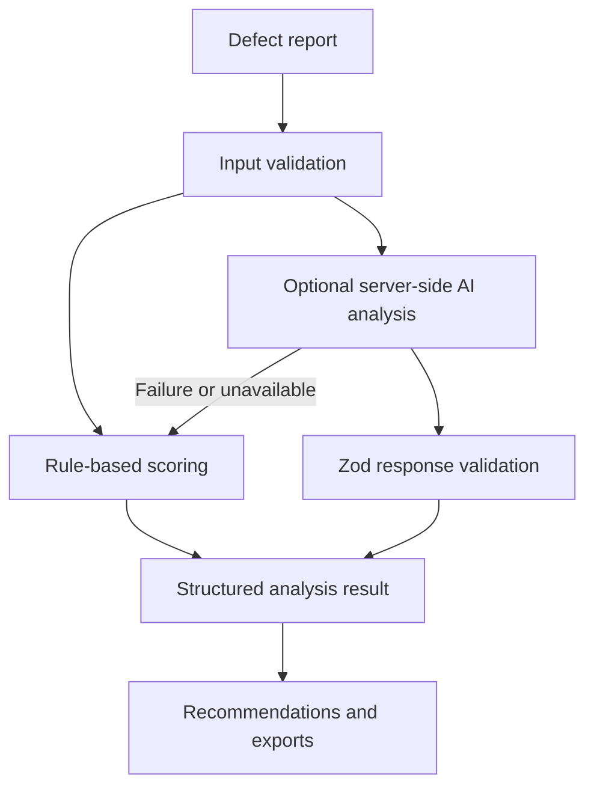
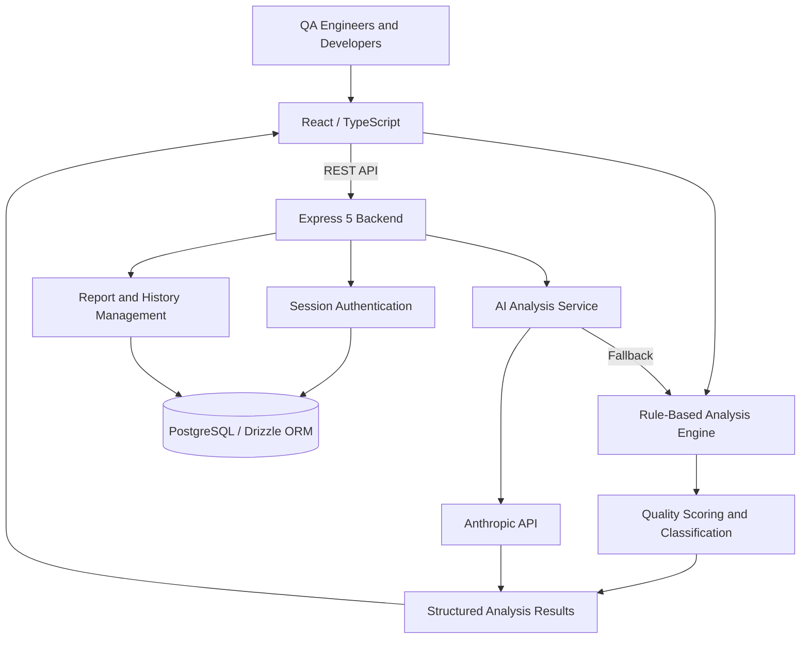
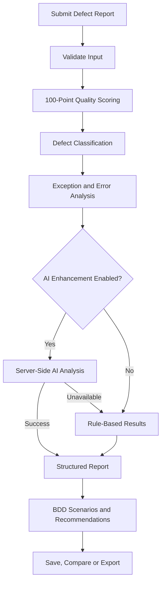
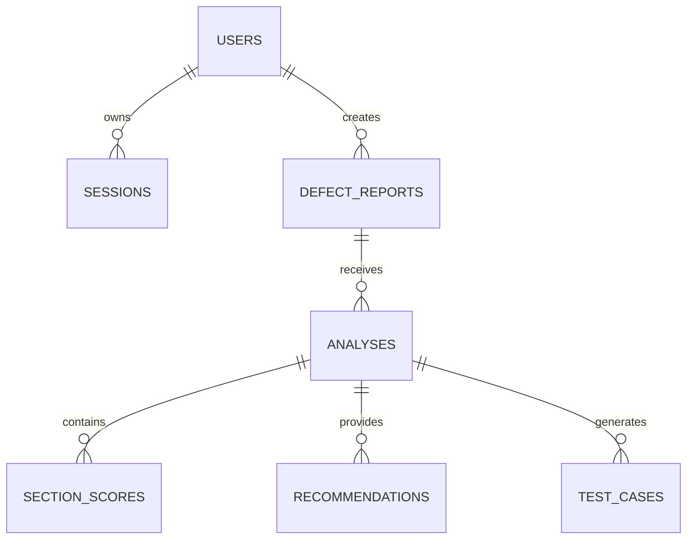

<div align="center">


# BugLens v2.0

### Defect Quality Intelligence Platform

**Analyze. Improve. Standardize.**

[](https://buglens-2be.pages.dev/)
[](https://github.com/9harshithp/BugLens-Defect-Quality-Checker/actions/workflows/ci.yml)
[](#technology-stack)
[](#technology-stack)
[](#technology-stack)

</div>

---
## Application Showcase

<div align="center">

[](https://buglens-2be.pages.dev/)

*BugLens — Turning confusion into clarity through intelligent defect quality analysis.*

[](https://buglens-2be.pages.dev/)

</div>

---
## Project Overview

BugLens is an intelligent software defect quality analysis platform designed to help QA engineers, developers, analysts, and software engineering teams improve defect reports before they enter engineering triage.

The platform evaluates report completeness using a deterministic 100-point scoring rubric, detects low-quality content, classifies defects, generates structured reports and test scenarios, identifies potential duplicates, and tracks quality trends.

Unlike conventional issue-tracking tools, BugLens focuses specifically on the quality, clarity, reproducibility, and actionability of defect reports.

**Live Application:** [buglens-2be.pages.dev](https://buglens-2be.pages.dev/)

---

## Problem Statement

Poorly written defect reports lead to:

- Unnecessary communication between QA and development teams.
- Incomplete reproduction steps.
- Missing environmental information.
- Incorrect defect classification.
- Duplicate defect reports.
- Delayed engineering triage.
- Inconsistent testing documentation.

BugLens addresses these challenges through standardized defect evaluation, actionable recommendations, and structured reporting.

---

## Core Capabilities

| Capability | Description |
|---|---|
| Defect Quality Analyzer | Evaluates reports using a 100-point quality rubric |
| Dual Analysis Engine | Deterministic rule-based and optional AI-enhanced analysis |
| Defect Classification | Categorizes defects across 11 engineering domains |
| Exception Analysis | Provides diagnostic hypotheses and suggested engineering teams |
| Report Generator | Creates structured and editable defect reports |
| BDD Generator | Produces Gherkin test scenario suggestions |
| Duplicate Detection | Identifies potentially similar historical reports |
| Report Comparison | Compares report quality and individual scoring sections |
| Analysis History | Maintains account-specific report history |
| Quality Dashboard | Visualizes defect quality trends |
| Multi-Format Exports | TXT, Markdown, HTML, JSON, CSV and printable PDF |
| Authentication | Backend-managed sessions and PostgreSQL persistence |

---

## Defect Quality Scoring Engine

BugLens uses a transparent, deterministic 100-point scoring system.

| Quality Dimension | Maximum Score |
|---|---:|
| Bug Title | 20 |
| Description | 20 |
| Steps to Reproduce | 20 |
| Expected and Actual Results | 15 |
| Environment | 15 |
| Severity | 5 |
| Attachments | 5 |
| **Total** | **100** |

### Quality Classification

| Score | Grade |
|---|---|
| 90–100 | Excellent |
| 75–89 | Good |
| 55–74 | Needs Improvement |
| 0–54 | Incomplete |

Each analysis includes section-level explanations and improvement recommendations.

---

## Dual Analysis Engine



### Rule-Based Analysis

- Deterministic scoring.
- Meaningless input detection.
- Report completeness evaluation.
- Missing information identification.
- Defect classification.
- Structured improvement recommendations.
- Offline-capable analysis.

### Optional AI Enhancement

- Server-side Anthropic integration.
- Validated structured JSON responses.
- Automatic rule-based fallback.
- AI-assisted report improvement.
- Context-aware recommendations.

The application remains functional without an AI API key.

---

## Defect Classification

BugLens supports 11 defect categories:

| Category | Focus |
|---|---|
| Functional | Application behavior |
| UI/UX | Interface and usability |
| Performance | Responsiveness and resource usage |
| API | Application interfaces |
| Database | Data operations and consistency |
| Authentication | Login and session workflows |
| Compatibility | Browsers, devices and platforms |
| Integration | Component communication |
| Configuration | Application configuration |
| Accessibility | Inclusive application usage |
| Regression | Previously working functionality |

Automatically suggested classifications remain editable by the user.

---

## Diagnostic Analysis

BugLens recognizes common exception and error categories, including:

- JavaScript exceptions.
- Java runtime exceptions.
- HTTP client and server errors.
- CORS errors.
- Timeout errors.
- Database errors.
- Dependency errors.
- Configuration errors.

Analysis results include possible causes, confidence indicators, recommended engineering teams, and diagnostic questions.

Diagnostic findings are presented as hypotheses rather than confirmed root causes.

---

## Professional Report and BDD Generation

BugLens transforms submitted information into a standardized, editable engineering report.

```text
DEFECT REPORT

Title
Description
Steps to Reproduce
Expected Result
Actual Result
Environment
Severity
Priority
Component
Additional Evidence
Missing Information
Quality Assessment
```

The BDD generator supports structured suggestions using Gherkin:

```gherkin
Feature: Application functionality

Scenario: Reported defect scenario
  Given the documented starting conditions
  When the reported action occurs
  Then the expected behavior should occur
```

Supported test categories:

- Positive scenarios.
- Negative scenarios.
- Boundary scenarios.
- Regression scenarios.

---

## Technology Stack

<div align="center">

### Frontend


### Backend and Database


### Development and Deployment


</div>

| Layer | Technology |
|---|---|
| Frontend | React 19, Vite |
| Language | TypeScript |
| Styling | Tailwind CSS |
| Icons | Lucide React |
| Backend | Node.js 24, Express 5 |
| Validation | Zod |
| Logging | Pino |
| Database | PostgreSQL |
| ORM | Drizzle ORM |
| Authentication | HttpOnly cookie sessions |
| Password Hashing | scrypt |
| AI Integration | Anthropic API |
| Testing | Vitest, React Testing Library |
| Package Management | pnpm Workspaces |
| CI/CD | GitHub Actions |
| Frontend Hosting | Cloudflare Pages |

---

## 🏗️ System Architecture

BugLens combines a deterministic defect quality analysis engine
with optional AI-assisted analysis and persistent report management.



### Defect Analysis Workflow



### Engineering Design

| Design decision | Purpose |
|---|---|
| Deterministic scoring engine | Consistent defect quality assessment |
| Optional AI enhancement | Additional report improvement |
| Automatic fallback | Analysis availability without external AI |
| Zod validation | Structured request and response validation |
| Scrypt password hashing | Password protection |
| HttpOnly session cookies | Session management |
| Drizzle ORM | Type-safe database operations |
| PostgreSQL | Persistent report and analysis history |
| GitHub Actions | Automated builds and testing |

### Architecture Highlights

- Modular TypeScript monorepo.
- Separation of frontend and backend.
- Offline-capable deterministic analysis.
- Server-side AI integration.
- Backend-managed authentication.
- Structured database persistence.
- Runtime schema validation.
- Automated CI checks.

---

## Database Design



This diagram represents the reported logical data model. Refer to the Drizzle schema for physical columns, constraints and indexes.

### Database Entities

| Entity | Purpose |
|---|---|
| users | Registered user accounts |
| sessions | Authenticated user sessions |
| defect_reports | Submitted software defect reports |
| analyses | Analysis results |
| section_scores | Individual quality dimensions |
| recommendations | Improvement suggestions |
| test_cases | Generated BDD scenarios |

---

## Engineering Highlights

| Engineering Area | Implementation |
|---|---|
| Quality Scoring | Deterministic, transparent scoring rubric |
| Content Validation | Empty and meaningless input detection |
| AI Reliability | Automatic rule-based fallback |
| Type Safety | TypeScript and Zod validation |
| Authentication | Backend-managed sessions |
| Password Security | scrypt password hashing |
| Data Persistence | PostgreSQL and Drizzle ORM |
| Reporting | Structured reports and multi-format exports |
| Analytics | Report-based quality trends |
| Automation | GitHub Actions CI |
| Deployment | Cloudflare Pages |

---

## Quality Analytics Dashboard

The dashboard provides visibility into defect quality using saved analysis records.

- Total analyzed reports.
- Average quality score.
- Passing and incomplete reports.
- Quality score trends.
- Grade distribution.
- Defect categorization.
- Report comparison and score differences.

---

## Export Formats

| Format | Purpose |
|---|---|
| TXT | Plain-text defect reports |
| Markdown | Technical documentation |
| HTML | Formatted reports |
| JSON | Structured data exchange |
| CSV | Historical analysis and analytics |
| Printable PDF | Professional report sharing |

---

## Local Development

### Prerequisites

- Node.js 24.
- pnpm.
- PostgreSQL.
- Git.

### 1. Clone the Repository

```bash
git clone https://github.com/9harshithp/BugLens-Defect-Quality-Checker.git
cd BugLens-Defect-Quality-Checker
```

### 2. Install Dependencies

```bash
pnpm install --config.strict-dep-builds=false
```

### 3. Configure PostgreSQL

```bash
export DATABASE_URL="postgresql://<user>:<password>@localhost:5432/buglens"
```

### 4. Initialize Database Schema

```bash
pnpm --filter @workspace/db run push
```

Use a dedicated local development database.

### 5. Start Backend API

```bash
PORT=5050 pnpm --filter @workspace/api-server run dev
```

### 6. Start Frontend

In a separate terminal:

```bash
PORT=3000 BASE_PATH=/ pnpm --filter @workspace/buglens run dev
```

Open:

```text
http://localhost:3000
```

---

## Environment Variables

| Variable | Purpose |
|---|---|
| DATABASE_URL | PostgreSQL connection |
| PORT | Application server port |
| BASE_PATH | Frontend base path |
| ANTHROPIC_API_KEY | Optional server-side AI enhancement |

Keep real database credentials and API keys outside source control.

---

## Testing and Verification

### TypeScript Validation

```bash
pnpm run typecheck:libs
pnpm --filter @workspace/buglens run typecheck
pnpm --filter @workspace/api-server run typecheck
```

### Unit and Component Tests

```bash
pnpm --filter @workspace/buglens run test
```

### Production Builds

```bash
PORT=3000 BASE_PATH=/ pnpm --filter @workspace/buglens run build
pnpm --filter @workspace/api-server run build
```

### Continuous Integration

[View the GitHub Actions CI pipeline](https://github.com/9harshithp/BugLens-Defect-Quality-Checker/actions/workflows/ci.yml)

The workflow badge displays the reported CI status. Refer to the latest workflow run for actual test and build results.

---

## Security and Reliability

- Server-side authentication.
- scrypt password hashing.
- HttpOnly cookie sessions.
- API rate limiting.
- Zod input and response validation.
- Server-side AI credential handling.
- Environment-based configuration.
- Account-specific report persistence.
- Graceful AI service fallback.

---

## What's New in v2.0

- Removed Jira integration.
- Replaced emoji-based interface elements with professional icons.
- Introduced PostgreSQL-backed persistence.
- Added backend-managed authentication.
- Expanded defect classification.
- Added duplicate report detection.
- Enhanced report comparison.
- Improved BDD generation.
- Expanded report export capabilities.
- Added automated CI verification.

---

## Deployment

| Component | Technology |
|---|---|
| Frontend Hosting | Cloudflare Pages |
| Backend | Express REST API |
| Database | PostgreSQL |
| Source Control | GitHub |
| Continuous Integration | GitHub Actions |

**Live application:** [buglens-2be.pages.dev](https://buglens-2be.pages.dev/)

---

## Contributing

Suggestions, bug reports and improvements are welcome through GitHub issues and pull requests.

---

<div align="center">

## Developer

### Harshith P

Backend Engineer | Full Stack Developer

[](https://github.com/9harshithp)
[](https://www.linkedin.com/in/harshithp914)
[](mailto:harshithp914@gmail.com)

**Turning confusion into clarity.**


</div>
